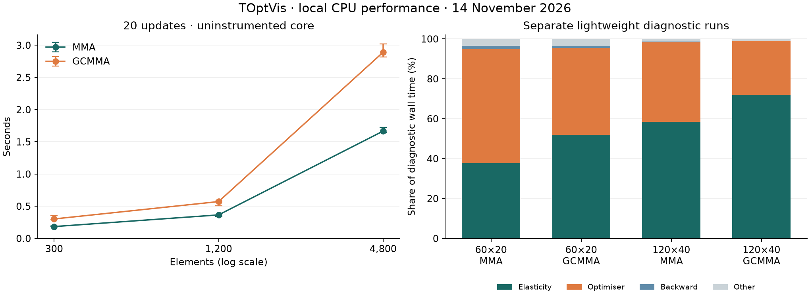

# Performance benchmark — 14 November 2026

Baseline source: `a5b80d0` (the click-to-start launcher). The subsequent source
changes only add `PERF B1`–`B4` comments; the numerical algorithm is unchanged.
Raw measurements: [Python/PETSc/HTTP JSON](results/2026-11-14.json) and
[browser renderer JSON](results/2026-11-14-render.json).



## Setup and limits

- Windows 11, Intel Core i7-13700H, 14 physical cores / 20 logical processors,
  approximately 15.71 GiB usable RAM. PyTorch used its existing 14-thread setting.
- Python 3.14.4; PyTorch 2.15.0+cpu; NumPy 2.5.4; SciPy 1.18.1;
  PETSc/petsc4py 3.26.1; mmapy 0.3.1. Real float64, sequential PETSc LU.
- Default unfiltered cantilever: length 3, height 1, volume 0.4, SIMP exponent 3,
  minimum modulus 1e-6, unit downward load at the free-edge midpoint.
- Baseline cases run serially, with three unprofiled repetitions after an
  unmeasured two-update warm-up. Timings include model creation and initial
  evaluation, and exclude Python imports, plotting/export, and HTTP/browser work.
- Available RAM before baseline trials was 1.18–1.40 GiB. Other applications
  remained open; CPU affinity, power mode, and thread settings were unchanged.
  These are local workstation measurements, not an idle-machine throughput
  limit. Paging was not measured, so memory pressure is a limitation rather
  than a demonstrated primary bottleneck.
- Fresh-process measurements use an already-running OS and cached files;
  they are not measurements after a cold boot.
- Component timings come from a separate warmed run with lightweight wrappers
  and PETSc event logging. cProfile runs are separate again and provide call
  counts/function rankings. Their overhead is visible in the raw data; do not
  substitute profiled wall times for the uninstrumented baselines.

All 24 baseline optimisation runs produced finite compliance and equilibrium
residuals below `2.05e-12`. No density filter or solver option was added.

## Uninstrumented core performance

Equal budgets of **20 outer updates**, including iteration-zero evaluation.
Cells show median seconds and the minimum–maximum over three repetitions.

| Mesh | Elements | Free DOFs | MMA | GCMMA | State solves, MMA / GCMMA |
| --- | ---: | ---: | ---: | ---: | ---: |
| 30 × 10 | 300 | 660 | 0.184 (0.184–0.192) | 0.302 (0.298–0.356) | 21 / 50 |
| 60 × 20 | 1,200 | 2,520 | 0.365 (0.341–0.366) | 0.572 (0.508–0.581) | 21 / 43 |
| 120 × 40 | 4,800 | 9,840 | 1.667 (1.644–1.725) | 2.891 (2.820–3.018) | 21 / 45 |

Increasing the element count fourfold from 1,200 to 4,800 increased median
runtime 4.56× for MMA and 5.05× for GCMMA. These finite mesh sizes do not
establish an asymptotic scaling law.

The actual default **100-update limit**, with the existing stability-based
early stopping, gives a different comparison:

| Optimiser | Median seconds (range) | Updates | State solves | Final compliance | Volume |
| --- | ---: | ---: | ---: | ---: | ---: |
| MMA | 1.910 (1.823–2.286) | 89 | 90 | 232.349 | 0.40000 |
| GCMMA | 1.752 (1.728–1.836) | 50 | 121 | 240.175 | 0.40000 |

GCMMA finished sooner in this particular default run, despite extra state
solves, because it needed fewer outer updates. Its final compliance was about
3.37% higher. Neither result certifies a global optimum; compare time, stopping
criteria, and final design quality together.

## UI latency and transport

One fresh local server took **2.957 s** to become ready. Each HTTP trial used
a fresh solver worker and the same 60 × 20, 20-update problem. Three trials
were recorded per optimiser; the server was already ready.

| Measurement | MMA median (range), seconds | GCMMA median (range), seconds |
| --- | ---: | ---: |
| Request → first topology frame | 2.397 (2.247–2.531) | 2.407 (2.317–2.529) |
| Request → stream EOF | 3.218 (2.973–3.388) | 3.499 (3.276–3.542) |

The separate fresh-process worker-module import probe took **2.413 s median**
(2.364–2.820 s). This supports numerical-stack imports/process startup as the
main cause of first-frame latency. The probe and HTTP runs were separate;
their times cannot be subtracted as matched components.

After streaming began, per-run median interframe gaps were 16.4–17.7 ms for
MMA and 23.6–25.3 ms for GCMMA. Each run sent 21 real topology frames, about
503–504 KiB total. The final-frame → EOF tail was approximately 0.43–0.47 s
(median per method); this includes worker shutdown/cleanup, which was not
isolated further. The interface keeps controls disabled until EOF.

## Marked bottlenecks

### B1 — fresh process and import cost on every Run

Marker: [`web/jobs.py`](../src/ml_opt/web/jobs.py), at worker creation.

The approximately 2.4 s first-frame delay is larger than the default warm
optimisation itself. Every click creates a new interpreter that imports
PyTorch, SciPy, and PETSc. The package's eager public-API imports also load the
numerical stack during server startup.

**Priority:** highest for perceived responsiveness. A controlled persistent
worker could amortise imports across runs. Any such change must preserve
cancellation, single-run isolation, and recovery after solver errors.

### B2 — general-purpose MMA/GCMMA subproblem kernel

Marker: [`optimizers/moving_asymptotes.py`](../src/ml_opt/optimizers/moving_asymptotes.py),
at the subproblem dispatch.

The subproblem routines consumed **76.1%** of the lightweight 30 × 10 MMA
diagnostic and **57.1%** at 60 × 20. In the separate 60 × 20 MMA cProfile run,
20 subproblems made 1,836 `scipy.sparse.diags` calls. The primal-dual
`mmapy.subsolv` routine is the main optimiser-side hotspot.

**Priority:** highest for small-mesh core throughput. Investigate sparse
diagonal construction and vector algebra inside the existing subproblem
solver. Preserve its numerical/KKT checks and upstream license; no backend
replacement or algebraic rewrite was performed for this benchmark.

### B3 — rebuilding the sparse solver and refactorising each state

Marker: [`fem/elasticity.py`](../src/ml_opt/fem/elasticity.py), at PETSc matrix creation.

The 120 × 40 diagnostics spent **58.4% (MMA)** and **72.0% (GCMMA)** in the
elasticity routine. PETSc symbolic plus numeric LU accounted for **43.2%** and
**53.5%** of those complete diagnostic runs, respectively. PETSc recorded one
symbolic and one numeric LU factorisation for every state evaluation.

**Priority:** highest as mesh size grows. The connectivity/sparsity graph is
fixed, yet CSR assembly, matrix, KSP, vectors, and symbolic setup are recreated.
Investigate reusing the graph, ordering, and solver workspaces. Changing
stiffness still requires updating numeric factors; reusing stale numeric LU
factors would give incorrect states and sensitivities.

### B4 — accepted GCMMA trial is solved again for sensitivities

Marker: [`runner.py`](../src/ml_opt/runner.py), at the evaluation after `optimizer.step`.

Exact consecutive modulus-array comparisons found **20 duplicate state solves
in 20 GCMMA updates**. GCMMA evaluates its accepted trial without sensitivities;
the outer loop then evaluates the same design with sensitivities, repeating
the PETSc solve. There were 43 total solves at 60 × 20 and 45 at 120 × 40.
The duplicate solves occupied **26.3%** and **31.2%** of their lightweight
diagnostic wall times.

**Priority:** a focused target for GCMMA. Retain the accepted trial's equilibrium
state/element energies for its gradient evaluation, with explicit validity
checks. Those percentages describe measured duplicate work, not a promised
end-to-end speedup after implementing a cache.

## Lower-priority costs

These measurements do not support prioritising PyTorch backward or canvas
rendering for the default problem.

| Cost | 60 × 20 | 120 × 40 |
| --- | ---: | ---: |
| PyTorch `autograd.grad`, all 21 sensitivity evaluations, MMA diagnostic | 6.67 ms (1.6% of run) | 8.00 ms (0.4%) |
| Snapshot conversion, median per final-design frame, MMA | 0.018 ms | 0.058 ms |
| Queue pickle, median per frame, MMA | 0.029 ms | 0.093 ms |
| JSON encoding, median per frame, MMA | 0.421 ms | 1.604 ms |
| JSON frame size, MMA | 25.7 KiB | 100.1 KiB |
| Browser topology draw, median per call | 0.650 ms | 2.300 ms |
| Browser geometry/mesh draw, median per call | 0.620 ms | 2.290 ms |

The canvas test ran the production `drawModel`/`drawTopology` functions in
Chromium 157, at 900 × 288 CSS pixels and device-pixel ratio 1.5. Each sample
averaged 30 calls, with three samples and a warm-up. At the UI's maximum
160 × 100 mesh, topology drawing was 7.57 ms and geometry drawing 8.06 ms.
That largest mesh was **render-only**, not a solver benchmark. These timings
exclude browser compositing/GPU completion, user-input latency, and display
refresh. Geometry redraws on pointer movement and full-density JSON messages
remain scaling costs, but they were not the dominant measured default costs.

## Reproduce

```powershell
.\.venv\Scripts\python.exe benchmarks\benchmark.py
.\.venv\Scripts\python.exe benchmarks\render_benchmark.py
```

The second command prints a loopback URL; opening it runs the actual renderer
and displays JSON results. Copy that JSON into a dated render result file.
The Python benchmark writes dated JSON under `benchmarks/results` and local
cProfile files under ignored `outputs/benchmarks`. Use
`python -m pstats outputs/benchmarks/60x20-mma.prof` to inspect a raw profile.
Generate the chart from the recorded JSON with
`python benchmarks/plot_results.py`. Three repetitions are sufficient for a
first ranking, not for statistical confidence intervals.
