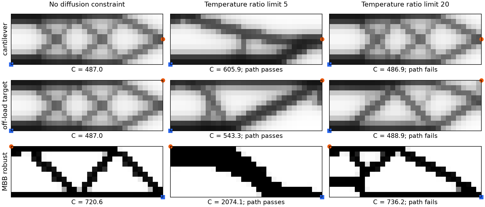

# Connection constraint conditioning

The current temperature limit can be demanding even when material already
connects the selected regions. On these small cases, the existing formulation
converged with a larger outer iteration budget. Replacing its row with a log,
cube root or constant scaling did not consistently improve convergence. Those
transformations remain experiments in the benchmark script, not solver changes.



Blue squares mark anchors and orange circles targets. The robust row shows the
nominal material; its constraint and path check use the eroded field. Markers in
the unconstrained column show the comparison regions; no diffusion solve or path
check is performed for that column.

## Setup and reproduction

All cases use 30 × 10 square cells over a 3 × 1 domain, volume fraction 0.4,
Helmholtz length 0.1, SIMP exponent 3, connection conductivity exponent 3,
void conductivity 1e-6, and the production PETSc/PyTorch implementation. The
outer iteration cap is 240. Convergence uses the existing design, objective,
feasibility and patience checks; reaching the cap is not called convergence.

- **Cantilever:** fixed left edge, downward unit load at the right edge centre;
  connection from bottom-left to right-centre. MMA, fixed projection sharpness 2.
- **Off-load target:** same mechanical problem, with the connection target at
  top-right instead. MMA, fixed projection sharpness 2.
- **MBB robust:** horizontal restraint on the left edge, vertical restraint at
  bottom-right, downward unit force at top-left; connection from bottom-right to
  top-left. GCMMA with three fields, threshold offset 0.1, and projection
  sharpness 2 → 4 → 8 → 16 every 25 completed iterations. Sequential field solves.

Run from the repository after its normal environment setup:

```sh
PYTHONPATH=src .venv/bin/python scripts/benchmark_connections.py
```

The script saves its exact case configurations, numerical results and densities
under `outputs/connection-benchmark/`. The checked-in [report](connection-conditioning.json)
contains the recorded configurations and all 24 runs. Timings are local warm
runs after the optimiser kernel warmup, not portable performance claims.

## Same temperature bound

Every run in this table satisfies the actual volume and temperature constraints,
and passes the separate face-connected path check at density ≥ 0.5.
Entries show **outer iterations / final compliance**; smaller compliance is better.

| Formulation or setting | Cantilever | Off-load target | MBB robust |
| --- | ---: | ---: | ---: |
| Existing linear row, ratio 5, move 0.2 | 176 / 605.85 | 207 / 543.32 | 122 / 2074.10 |
| Log row, same feasible set | 200 / 605.86 | 229 / 543.28 | 125 / 2067.62 |
| Cube-root row, same feasible set | 179 / 605.60 | 216 / 538.17 | 126 / 2067.62 |
| Row divided by its initial response | 228 / 605.60 | 237 / 538.17 | 104 / 2058.32 |
| Existing row, smaller move 0.05 | 185 / 600.13 | 148 / 538.23 | 122 / 2091.36 |

The transformed rows are, respectively, `log(1+g)`, `(1+g)^(1/3)-1`, and
`g/max(1,1+g_initial)`, with the corresponding chain-rule gradients. Trial
evaluations use the same transformation as the current evaluation. Reporting
and outer convergence always use the original physical row `g`.

No single alternative wins across these cases. The smaller move helps the
off-load target, while constant scaling helps the robust case's iteration count
but slows both cantilevers. A scaling change alone is not supported as a general
fix. The different compliant solutions are local results, not certified optima.

## Why the constraint changes the design

With uniform physical density ρ, every face conductivity scales by
`k = ε + (1-ε)ρ³`. Temperature therefore scales approximately as `1/k`.
At ρ = 0.4 this is about 15.6 times the fully solid response. A ratio limit
of 5 demands a concentrated conducting path from the beginning. Projection,
especially the eroded field, can make the initial violation larger.

This surrogate constrains thermal resistance as well as connectivity. For
comparison, the unconstrained compliance values are 486.96, 486.96 and 720.64.
The extra material allocation, projection schedule and local minima can produce
large compliance differences; those differences alone do not demonstrate an
incorrect gradient or failed optimiser.

Simply increasing the ratio changes the physical constraint. At limit 20 all
three runs satisfy the temperature bound but fail the geometric path check;
the off-load run also reaches its outer cap. At limit 10 the off-load case
already fails the path check despite solver convergence. A looser bound is
therefore not a reliable connection fix.

## Practical settings

For these cases, allow around 300 outer iterations while keeping the requested
temperature bound. If density changes oscillate, try move limit 0.05; it is a
case-dependent adjustment, not a universal improvement. Check the temperature
constraint, geometric path check, and convergence separately. These small-mesh
results do not establish suitable limits for another mesh or region selection.

The [method description and research links](../GUIDE.md#connections-through-pseudo-temperature)
explain the surrogate and its limitations. No connection defaults or numerical
backend were changed by this investigation.
